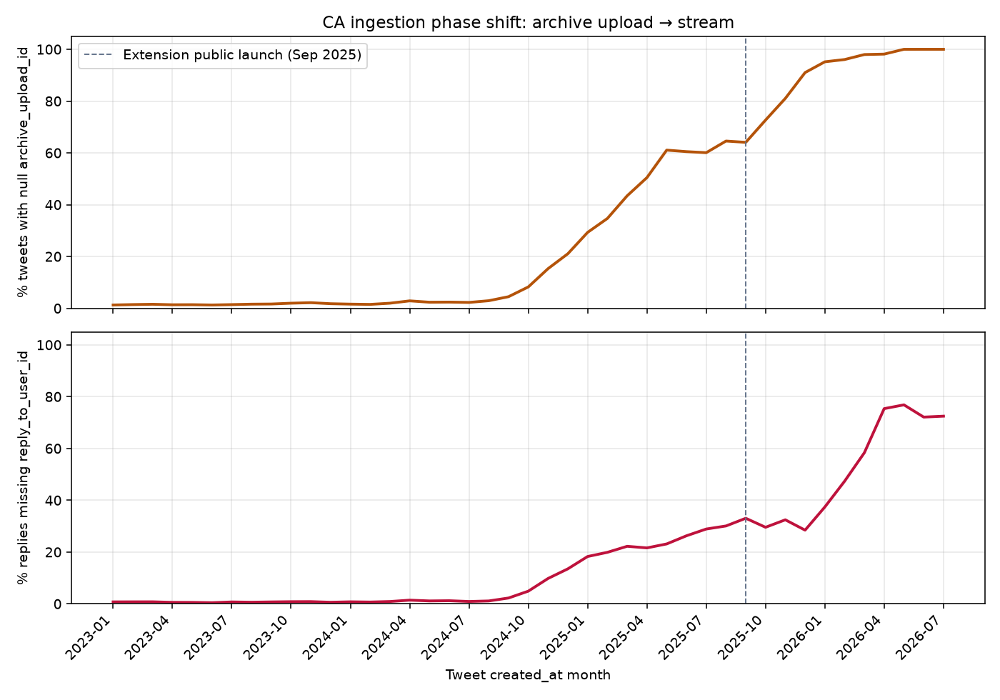
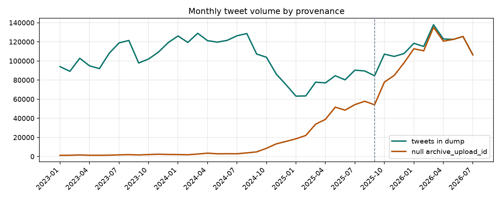

# CA data-quality audit (adversarial)

Date: 2026-07-24  
Dump: `enriched_tweets.parquet` (8,314,040 rows; `created_at` through 2026-07-24)  
Artifacts: `logs/ca_dq/` (`monthly_dq.csv`, `yearly_dq.csv`, charts).
Re-run: `uv run audit_ca_quality.py`

## Verdict

Community Archive has two ingestion regimes that **do not produce interchangeable rows**. Classic Twitter archive uploads (dense, likes/followers included, reply fields complete) dominate through ~2024. From late 2024 and especially 2025–2026, **browser-extension streaming** supplies nearly all new tweets. Streams capture tweets *seen while browsing*, not full histories — no likes graph, incomplete reply metadata, and engagement counts frozen near observation time.

Our global time holdout therefore evaluates almost entirely on stream-era rows while training still sees a large upload-era block. Several leakage-safe features (`reply_to_user_id` inbound rates especially) systematically go dark on the eval window.

---

## Phase change: upload → stream

### What changed operationally

- Archive uploads: full ZIP exports → `archive_upload` rows → tweets/likes/followers/media tied to `archive_upload_id`.
- **Community Archive Stream** extension (public write-up 2025-09-19; Chrome listing 0.0.3 on 2025-09-18): records public tweets visible on screen; writes accounts/tweets/media/urls/mentions — **not** likes, followers, or following ([stream docs](https://github.com/ri72miieop/community-archive-stream); open issue [#427](https://github.com/TheExGenesis/community-archive/issues/427)).
- Early stream policy: any account *mentioned* in CA (not only opted-in). Opt-in table currently ~265 users; `all_account` has ~502k rows.

### Provenance signal we can measure

`tweets.archive_upload_id IS NULL` is a strong stream proxy (likes/followers never have null upload id; media *can*).

| Year | Tweets in dump | % null `archive_upload_id` | % replies missing `reply_to_user_id` |
|------|----------------|----------------------------|-------------------------------------|
| 2023 | 1.25M | 1.6% | 0.7% |
| 2024 | 1.36M | 4.7% | 2.6% |
| 2025 | 1.03M | **62%** | **27%** |
| 2026 | 0.85M | **98%** | **63%** |

By month (eligible for modeling, ≥50 non-RT tweets / account, ≤8000):

| Window | % stream (null upload) | % replies missing uid |
|--------|------------------------|------------------------|
| 2024 | 21% | 15% |
| 2025 | 79% | 42% |
| 2026 | **99.6%** | **68%** |

June–July 2026 in the dump: **100%** of tweets have null `archive_upload_id`.

Hybrid authors (both upload-linked and null-upload tweets): only **327** of ~35k accounts in the parquet. Most stream volume is not “refresh after an archive”; it is a different sampling process.

### Account table gotchas

- `created_via`: mostly `twitter_import` (~376k) and `twitter_fetched` (~126k); uploaders also appear as `twitter_archive`.
- `twitter_fetched` rows often have huge `num_tweets` / `num_followers` from **profile snapshots** while CA stores 1–4 actual tweets and **0 likes / 0 followers table rows**. Never treat `all_account.num_*` as corpus completeness (already banned as features for leakage; also wrong as coverage proxies).

---

## Issue inventory (prediction-relevant)

### 1. Likes / social graph only from archives (confirmed)

- `likes.archive_upload_id` null count: **0**. Same for `followers` / `following`.
- Completed uploads: 384; **65** with `upload_likes=false` (likes intentionally skipped even on upload).
- Spot checks: upload accounts have thousands–hundreds of thousands of `likes` rows; high-`num_tweets` `twitter_fetched` accounts have **0** likes rows.
- **Impact on us:** we already avoid undated likes as features (good). Residual risk is any future “audience affinity via likers” idea, and any human intuition that CA “has likes” for recent active accounts — it mostly doesn’t.

### 2. `reply_to_user_id` / `reply_to_username` missing on recent replies (high impact)

Upstream issue [#404](https://github.com/TheExGenesis/community-archive/issues/404): ~481k replies with parent tweet id but null user fields; 92% in 2025–2026.

In the current dump: **560,764** such rows. Among replies, missing-uid rate rises from &lt;1% (2023) to **~63% (2026)**. Absolute `reply_to_user_id` events fall from ~90k/month (2024-08) to ~19k/month (2026-07) even as reply volume stays large.

**Impact on us:** `prepare.py` `load_author_graph` builds inbound popularity via:

1. `reply_to_tweet_id` → parent (still OK if parent is in dump),
2. **`reply_to_user_id` → author** (silently undercounts post-2024),
3. `quoted_tweet_id` → author.

`hist_*_replies` / dump-wide reply rates used as the main leakage-safe popularity signal are therefore **regime-dependent**. Time-holdout Spearman can look like “model failure” when part of the feature is structurally missing on val.

### 3. Label semantics: dump `favorite_count` / `retweet_count` are not one process

| Provenance | Typical `updated_at − created_at` | Interpretation |
|------------|-----------------------------------|----------------|
| Archive upload (older tweets) | median lag sample ~390 days | Counts matured then frozen at archive request |
| Stream (2026 sample) | median lag ~0.04 days | Counts near scrape/view time |

Exposure-rate targeting (`log1p(eng/(min(age_days,30)+1))`) partially corrects maturity, but:

- Stream labels are **observation-time** engagement, often on tweets selected because someone scrolled them (viral / in-network bias).
- Upload labels for old tweets are closer to “eventual” at archive time, but still not fixed-horizon.
- Mean eng on 2025+ stream rows is **higher** than upload-linked rows in the same age buckets — consistent with **visibility sampling**, not just maturity.

### 4. Incomplete author timelines (stream sampling)

Extension FAQ: only tweets an extension user visibly loads; initially any mentioned account, later opt-in. So for a given author after their last archive:

- Gaps are the norm (not missing-at-random w.r.t. engagement).
- `hist_n` / tweet-rate features drop for active famous accounts who only appear when scrolled.
- Per-account caps in `prepare.py` still prefer accounts with ≥50 stored tweets — those accounts’ **recent** tweets are still stream-quality.

### 5. Media / URLs — mixed, not a pure regression

- Stream path **does** write `tweet_media` (null-upload media rows: ~1.9M vs ~0.65M with upload id).
- API samples: media rate on null-upload 2025/2026 tweets similar or higher than upload-2024 (~14–20% vs ~12%); expanded URL rate a bit lower.
- Sparse media was already a known scoreboard flat (v18); provenance is not the main media failure mode.

### 6. Parent / quote coverage — not uniformly worse

- Quote-parent presence sample: **91/100** parents found for 2026 quotes vs **60/100** for 2023 — streaming may *improve* in-network parent availability.
- Reply parents via `reply_to_tweet_id` remain joinable when the parent was also streamed/uploaded; user-id backfill still missing ([#404](https://github.com/TheExGenesis/community-archive/issues/404) suggests ~30% recoverable from parent author).

### 7. Conversation ids improved recently

Null `conversation_id`: ~56% in 2023 → **~9% in 2026**. Streaming appears to populate conversation metadata better than many older uploads. Secondary for our current feature set.

### 8. Archive upload pipeline health

- Recent `archive_upload` rows: many **`failed`** (25 failed vs 384 completed; latest batch Jul 2026 all failed in the sampled head).
- Upstream fix 2026-06-11 for silent data loss (worker marked `completed` after rolled-back inserts) — [#373](https://github.com/TheExGenesis/community-archive/issues/373)-family. Failed re-uploads mean some users’ post-archive years only exist as stream scraps.
- Avatar overwrite bug from extension field-path change ([#250](https://github.com/TheExGenesis/community-archive/issues/250), fixed) — reminder that stream upserts can clobber richer upload fields.

### 9. Stale / misleading aggregates in CA

- `global_activity_summary`: `total_accounts=335` while `all_account` count ≈502k — matview not trustworthy.
- `global_monthly_tweet_counts` stops at **2025-09** in API; dump has full 2025–2026 — don’t use that matview for current phase analysis.
- Pre-Twitter `created_at` junk: 5 rows (1998–2004). Harmless at our scale.

### 10. Already-known leakage / snapshot issues (still true)

Documented in `AGENTS.md`: dump-time fav/RT as history, `num_followers`, mutable display names. These interact with the phase change: stream era makes follower snapshots even less related to “who was in CA at T”, and makes fav/RT history even more non-comparable across regimes.

---

## Direct impact on will-it-bang

Global time split (`train.py` `time_split`): on a prepare-like eligible pool, the **latest quintile is 99.9% stream** with **73% of replies missing `reply_to_user_id`**. Quintile 1–2 are ~13–15% stream.

So today:

1. **Train** mixes upload-complete histories with early stream.
2. **Val** is almost pure stream: thinner author histories, broken `reply_to_user` graph features, observation-biased labels.
3. Within-account ranking can still be meaningful *inside* an author×era, but account TE / hist reply levels are calibrated on a different measurement process than val.
4. Failure slices that look like “viral under-pred” or “nonreply hard” may partly be **label process shift** and **feature dropout**, not just model capacity.

---

## Recommended follow-ups

1. ~~**Provenance stratum in analyze:**~~ **done** — prepare carries `archive_upload_id` / `is_stream`; `analyze.py` reports wa_* by upload vs stream (optional train feature / upload `end_date` still open).
2. ~~**Repair `reply_to_user_id`:**~~ **done** — `load_author_graph` coalesces null uid from parent `account_id` when parent ∈ dump; sampled rows get the same for `is_self_reply`. Rebuild features to densify `inbound_replies*`.
3. ~~**Holdout policy:**~~ **tried (v36b/d)** — `upload_era` / `stream_only` knobs in `train.py`; upload_era still leaves val ~stream and hurts wa_nr; keep `time` default.
4. ~~**Provenance×age features:**~~ **done (v36c)** — default `--provenance-features` (`stream_x_log_age` carries the lift).
5. **Label honesty:** treat stream eng as “as-observed”; `--stream-fresh-days` exists but untested as a scoreboard bet.
6. **Don’t build on likes** until extension or a new source captures them with timestamps.
7. **Refresh awareness:** re-run `audit_ca_quality.py` when CA changes stream policy (opt-in-only threshold in their FAQ) or fixes #404/#427.

Backlog in `experiments.md`: holdout knobs + provenance features landed; stream-fresh down-weight still open.
